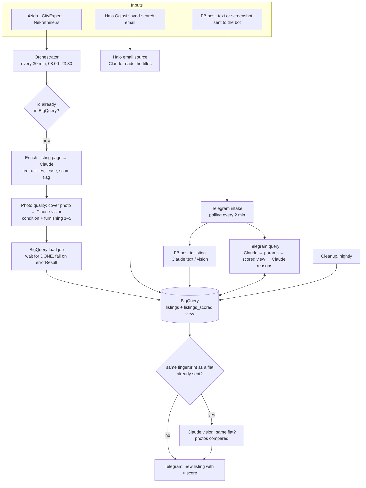

# Stan Hunter

An n8n automation that watches the Belgrade rental market for me. It pulls new apartment listings from four sites every 30 minutes, stores everything in BigQuery, uses Claude to read what no site structures (the free-text description and the photos), scores every listing 0–100, and talks to me through a Telegram bot: new listings arrive as messages, and I can ask the bot questions like *"best two-bedroom flats in Vračar under 500 €"*.

Self-hosted on a laptop with Docker. User-facing text (Telegram messages, LLM output) is in Serbian because the market and the listings are Serbian; code, docs and workflow notes are in English.

## What it does

- **Ingest:** 4zida, CityExpert and Nekretnine.rs every 30 min from 08:00 to 23:30 (after the night pause the sources page back until they reach a listing they already know); Halo Oglasi through its saved-search emails (the site sits behind a Cloudflare bot challenge, which I don't bypass). An email shows only the first 5 new listings, so there is one saved search per municipality: each daily email stays under 5, and Claude reads municipality, size and rooms from the listing title; Facebook group posts that I forward to the bot as text or as a **screenshot**.
- **Deduplicate:** a listing is new only if its id is not in BigQuery yet. The same flat posted on several sites is found in two steps: a cheap fingerprint (price + m² + rooms + municipality) finds candidates, and Claude vision compares the photos to confirm. A confirmed duplicate becomes a one-line note with both links; a Facebook screenshot of a flat that is already in the database gets "already have it" with its score instead of a second row.
- **Enrich with an LLM:** for new 4zida listings the pipeline fetches the listing page and Claude extracts the hidden costs from the description: agency fee, utilities, minimum lease, deposit, plus a scam flag.
- **Rate the photos:** Claude vision looks at the cover photo of every new listing and rates condition and furnishing 1–5, so a cheap flat with bare walls and old radiators sinks in the ranking.
- **Score every listing:** a BigQuery view computes a deterministic 0–100 score; every new-listing message shows it (`⭐ 71/100`, `📸 3/5 – renovated, furnished`).
- **Ask in natural language:** `/top` and `/pitaj` turn a question into validated query parameters, BigQuery ranks listings with the same score, and Claude writes a one-line reason for each pick.
- **Maintain itself:** a nightly cleanup removes listings that no longer exist; a ❌ button under every answer removes one immediately; alerts go to Telegram when anything breaks.

## Architecture



All workflows are in [`workflows/`](workflows):

| Workflow | Trigger | What it does |
|---|---|---|
| `orchestrator` | every 30 min, 08:00–23:30 | Runs the sources, keeps new ids, calls both Enrich steps, loads BigQuery and verifies the load job, reads scores from the view, sends Telegram messages, checks source health |
| `source-4zida` | sub-workflow | Undocumented JSON API found with DevTools |
| `source-cityexpert` | sub-workflow | JSON API found in the Angular transfer state (`ng-state`) |
| `source-nekretnine-rs` | sub-workflow | Next.js `__NEXT_DATA__` from the server-rendered HTML |
| `source-halo-oglasi-email` | Gmail, hourly | Parses the saved-search email (the site itself is behind Cloudflare) |
| `source-halo-oglasi` | disabled | HTML scraping version, kept for reference; blocked by Cloudflare |
| `enrich-listing-description-claude` | sub-workflow | Listing page → description → Claude JSON → validated fields |
| `enrich-photo-quality-claude-vision` | sub-workflow | Cover photo URL → Claude vision → condition and furnishing 1–5 + a short description |
| `dedup-same-flat-check-claude-vision` | sub-workflow | Two listings with the same fingerprint (or an FB screenshot and a listing) → Claude compares the photos → same / different / unknown |
| `telegram-intake-polling` | every 2 min | `getUpdates` polling, commands, screenshots, ❌ buttons |
| `fb-post-to-listing` | sub-workflow | Claude turns an FB post (text or screenshot) into a listing |
| `telegram-query` | sub-workflow | Natural-language question → parameters → BigQuery → reasons |
| `cleanup-inactive-listings` | nightly 00:12 | Removes listings that are gone, with a backup and a safety stop |
| `error-alerts-telegram` | Error Trigger | Shared error workflow: redacted, throttled Telegram alerts |
| `bigquery-ddl-utility` | manual | Schema changes and one-off maintenance queries |

## How the LLM is used (and where it is not)

The rule I ended up with: **deterministic code wherever the answer must be exact and repeatable, the LLM only where the input is free text.**

- **Text-to-parameters, not text-to-SQL.** Claude turns *"cheapest two-bedroom in Dorćol under 450"* into JSON (`max_cena`, `min_sobe`, `opstine`, `sortiraj`, …). Code clamps every value, and the SQL is fixed with named parameters. The service account can run DDL, so LLM-written SQL would be a real risk.
- **Deterministic ranking, LLM explanation.** When Claude picked "the best" listings on its own, the cheapest outskirts always won and the order changed between runs. Now a BigQuery view (`listings_scored`) computes a 0–100 score: location 30 %, photo quality 30 %, price 15 %, price/m² 10 %, size 10 %, furnished 5 %. Photo quality weighs as much as location on purpose: a great street doesn't fix a flat with bare walls and 1980s radiators. Each part is normalised to 0–1 first and unknown values get a neutral default. New-listing messages and `/top` read the same view, so there is one definition of "good". Claude only writes the reason, and every number in a reply is printed from the database, never from the model.
- **Structured output with validation.** Extraction prompts ask for one JSON object; code checks types, ranges and allowed values and falls back to `null` / `nepoznato`. Structured fields from the site always win over the LLM.
- **Cheapest layer first.** 4zida already exposes deposit, pets and "no agency fee" as tags (layer A, free). The LLM (layer B) is used only for what nobody structured, only for new listings that pass the filter, at most 10 per run.
- **Vision for photos.** The listing photo is the one thing no site describes in a field. Claude gets the cover photo URL (nothing is downloaded) and returns two 1–5 ratings plus up to eight words. Only new listings that pass the filter are rated, at most 15 per run, each exactly once (~1k tokens). A photo that isn't an interior returns `null` and counts as neutral.
- **Vision for screenshots.** Facebook can't be scraped (and shouldn't be), so I screenshot a post on my phone and share it to the bot; Claude reads the image with the same schema as the text flow, and rates the photos in it on the same 1–5 scale.
- **Deterministic candidates, LLM tie-breaker.** Deduplication by fingerprint alone either misses duplicates (sites spell neighbourhoods differently) or merges different flats that happen to share price, size and municipality. So the fingerprint only *proposes* candidates (the last three flats sent with it, including listings from the same run), and Claude decides by looking at the photos of each pair (furniture, rugs, windows, floors). It must be ≥ 0.7 confident to call it the same flat; anything unclear (no photo, API error, unreadable answer) is treated as a different flat, so a listing is never silently lost. The vision call only runs on collisions, a few times a day.
- **Graceful degradation.** If the site, the model or the JSON fails, the listing is stored without the extra fields. Enrichment can never block ingestion.
- **Data minimisation.** Phone numbers and agent names are stripped before text is sent to the model; the bot ignores names in screenshots.

## Reliability

- One shared **error workflow** sends a Telegram alert for any production failure, with secrets redacted and repeats of the same error throttled to one per hour.
- **Source health check:** a source that errors or returns zero listings twice in a row (~1 h) raises an alert, with a reminder every ~6 h and a recovery message.
- The Telegram poller **classifies API errors**: 5xx, 429 and network errors are skipped until the next poll; anything else (e.g. a revoked token) fails the run and alerts.
- **Idempotent ingest:** "new" means "not in BigQuery yet", so a failed load is simply retried on the next run instead of being lost.
- **Load jobs are verified.** The Orchestrator polls the BigQuery load job until it is `DONE` and fails the run on `errorResult`; timestamps are validated before the load, because one bad row rejects the whole job.
- **Catch-up after downtime:** the laptop pauses the pipeline at night (and sometimes sleeps); sources page back (max 5 pages, 1 s apart) until they hit a known id, so nothing published overnight is skipped.
- **Safe deletes:** BigQuery sandbox has no DML, so deletes are `CREATE OR REPLACE TABLE … WHERE id NOT IN (…)`, always after a backup, and the nightly job refuses to delete if more than half of the checked listings look dead (that usually means the site changed, not the market). A source whose search returns a full page is never used as proof that a listing is gone.
- **Bot protection is respected.** One request per source per run, no proxy rotation or captcha solving. Where a site blocks bots, the project uses an official channel instead (saved-search email) or ages listings out.

## Data model

One table, `stan_hunter.listings`, partitioned by ingest date ([`sql/schema.sql`](sql/schema.sql)). Column names are Serbian because they mirror the domain; [`sql/schema.sql`](sql/schema.sql) also defines a `listings_en` view with English names.

| Column | Meaning | Column | Meaning |
|---|---|---|---|
| `izvor` | source | `prosao_filter` | passes my filter |
| `naslov` | title | `upisano` / `objavljeno` | ingested / published at |
| `cena` | monthly rent, € | `depozit_eur` | deposit |
| `sobe` | rooms (0.5 = studio) | `kucni_ljubimci` | pets allowed |
| `opstina` / `naselje` | municipality / neighbourhood | `provizija` / `bez_provizije` | agency fee / no fee |
| `namesten` | furnished | `rezije_eur` | utilities estimate |
| `oglasivac` | agency or owner | `min_period_meseci` | minimum lease (months) |
| `grejanje` | heating | `sumnjiv_oglas` / `sumnjiv_razlog` | scam flag / reason |
| `kvalitet` | photo quality 1–5 (vision) | `kvalitet_opis` | photo description (vision) |

The `listings_scored` view adds `lok` (location tier 1–5), `cena_po_m2` and `ocena` (the 0–100 score).

## Stack

n8n 2.47 (self-hosted, Docker Compose, external task runners for Code nodes) · BigQuery sandbox (batch load jobs through the REST API) · Claude (Haiku, text and vision) through the n8n Anthropic node · Telegram Bot API (long polling) · Gmail API · JavaScript in Code nodes.

## Run it yourself

1. `cp .env.example .env` and fill in the two secrets, then `docker compose up -d` and open `http://localhost:5678`.
2. Create a GCP project with a BigQuery dataset `stan_hunter` (EU) and a service account with *BigQuery Data Editor* + *Job User*; run [`sql/schema.sql`](sql/schema.sql).
3. In n8n create credentials: Google Service Account (scope `https://www.googleapis.com/auth/bigquery`), Anthropic, Telegram, Gmail OAuth2.
4. Create a data table `stan_hunter_kv` with rows `telegram_bot_token` and `telegram_offset` (the poller needs the token in the URL path, which an n8n expression can't read from a credential).
5. Import the files from `workflows/`, map the credentials, replace the placeholder Telegram chat id `123456789` with yours, and publish the sub-workflows before the Orchestrator.

To update the repo from a running instance:

```bash
docker exec n8n n8n export:workflow --all --separate --output=/home/node/.n8n/export/
docker cp n8n:/home/node/.n8n/export ./export
python3 scripts/sanitize_workflows.py export workflows   # fails if anything looks like a secret
```

## Lessons learned

A few of the ~51 notes I kept while building it:

1. **Look at what the source really returns before designing the AI layer.** I planned "Claude reads the description" before noticing the 4zida list API has no description at all; half of what I wanted was already in structured tags.
2. **Server-rendered sites hide their API in the page.** CityExpert's list isn't an XHR call, it's in the Angular transfer state; Nekretnine.rs ships React Query state in `__NEXT_DATA__`.
3. **Dedup memory that commits before the write loses data.** n8n's "remove items seen in previous executions" remembers ids even if the BigQuery upload after it fails. Checking against the warehouse fixed it.
4. **`continueErrorOutput` without a handled error branch swallows everything,** including the errors you need to know about (like a revoked token).
5. **Thinking tokens count against `maxTokens`.** A 700-token limit silently cut the JSON in half; if `outputTokens == maxTokens`, the answer was truncated.
6. **The Telegram node sends HTML,** so `<`, `>` and `&` from scraped titles or error pages break messages, and the alert for an error containing an HTML page would never arrive unless escaped.
7. **BigQuery sandbox blocks DML but allows DDL,** so deletes become table rebuilds and new fields must exist as columns before the load job sees them.
8. **A 200 doesn't mean a page exists** on an Angular site, and a 403 says nothing about whether a listing exists. Each site needs its own "is it gone?" rule.
9. **Telegram serves files as `application/octet-stream`;** vision APIs want a real image MIME type.
10. **Secrets leak through execution data,** not just through code: a downloaded file's metadata contained the bot URL with the token. Strip it before it reaches a sub-workflow.
11. **A green run is not a successful run.** The load job was only started, never checked. One row with `upisano: "true"` made BigQuery reject every load for three hours while n8n showed success. An async job isn't done until you've read its status.
12. **Changing one parameter can break another workflow's assumption.** Raising the price limit to 600 € filled CityExpert's search to a full page, and the cleanup ("not in the search = deleted") removed 11 live listings. The backup saved them; now the rule is in code: a full page means "don't know".
13. **A truncated answer looks like a valid one.** The photo rating returned HTTP 200 with half a JSON object, so listings looked like "photo unknown". `maxTokens` is a ceiling, not a price, so set it generously, and parse what you can from a partial answer.
14. **Work within the limits a site gives you.** Halo's email shows 5 of N new listings, and the listing pages are behind a bot challenge. Instead of fighting the challenge, I split one saved search into six (one per municipality) so every email fits under the limit.
15. **Facebook Marketplace shows prices in the viewer's account currency.** A 500 € flat appeared as `$500/month`, and the model helpfully converted it to 460 €, which broke both the score and the duplicate check. The prompt now says: in Belgrade rentals `$` is the same number in euros.
16. **Dedup is a precision/recall trade-off, so don't make it silently.** Matching on neighbourhood missed duplicates; matching on municipality risked hiding a different flat. The fix wasn't a better key but a second, smarter step only for the ambiguous cases, with a fail-open default.
17. **A backlog tests what a normal run doesn't.** After a day offline, one run carried 23 listings. Two ads of the same flat arrived together and were each compared only with an older, different flat stored under the same fingerprint, so both went out in full. Every verdict was right; the system was comparing the wrong pairs. Now a fingerprint keeps the last three flats, and listings in one run are compared with each other.
18. **"Seen in previous executions" means previous.** The same Halo listing came in two emails of one run (a municipality search and the old combined one) and was sent twice, because n8n's dedup only remembers earlier runs. Duplicates inside a batch need their own step.
19. **Check that a fallback can actually fire.** The "5 of N listings in this email" button matched only the combined search's link format; municipality emails use a different URL, so an overflowing one would have gone unnoticed. I found it only by testing with real emails.

## What I'd do next

The project is feature-frozen; these are the next steps I'd take, in order of value:

- **Rate photos once per flat, not per listing.** The same flat on two sites gets two ratings today (rare, ~1k tokens each).
- **Webhook instead of polling** (domain + Cloudflare Tunnel), so the bot answers instantly instead of within 2 minutes.
- **A `runs` table with per-run metrics** (listings per source, tokens, load-job time) and a small dashboard on top of it.
- **Move off the laptop** to a Compute Engine VM on Google Cloud, next to BigQuery, with secrets in Secret Manager instead of n8n data tables.

## License

MIT
